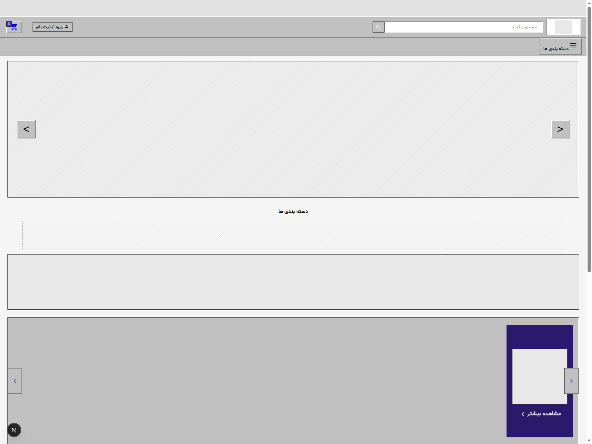

# Mashkala

A Persian (RTL) industrial-tools e-commerce storefront, rebuilt into a modern, fully-typed **Next.js 16** application with a cart, blog, authentication, and a polished, accessible UI.

This is a demo/portfolio project. There is no backend, payment gateway, or real authentication provider — all "functional" flows (checkout, login, comments, newsletter) run entirely client-side with simulated network delays, so the UI/UX can be evaluated end-to-end without any server setup.

## UI preview



---

## Features

- **Shopping cart** — add/remove/update quantities, discount codes, shipping calculation, order summary, checkout flow with loading & success states, empty/loading states, persisted to `localStorage`
- **Blog** — article listing + detail pages with table of contents, rich content blocks (headings, images, quotes, code, lists), tags, social sharing, related articles, comments, and prev/next navigation
- **Authentication pages** — polished login & register cards with client-side validation, inline errors, and loading/success states
- **Full site navigation** — expanded header menu, mobile slide-in drawer, and a categories mega-menu with nested sub-categories and hover/keyboard support
- **Newsletter** — reusable, validated subscription form (footer + blog)
- **Fully responsive** — desktop, tablet, and mobile layouts, including a dedicated mobile bottom navigation bar
- **Accessible** — semantic HTML, ARIA attributes, keyboard navigation, and focus states throughout
- **Consistent design system** — every new feature reuses the original palette, typography (Shabnam), spacing, radius, and shadow language rather than introducing a new visual style

## Tech stack

| | |
|---|---|
| **Framework** | [Next.js 16](https://nextjs.org/) (App Router) |
| **Language** | TypeScript (strict mode) |
| **UI** | React 19 |
| **Styling** | Plain CSS (`app/globals.css`) — see [Notes on styling](#notes-on-styling) |
| **State** | React Context (`CartContext`) + component-local state |
| **Linting** | ESLint (flat config, `next/core-web-vitals` + `next/typescript`) |
| **Images/Fonts** | `next/image` + `next/font`-friendly local webfont |

No external services, API keys, or environment variables are required.

## Pages / routes

| Route | Description |
|---|---|
| `/` | Homepage — hero slider, categories, featured products, blog rail, "why us" |
| `/cart` | Shopping cart with summary, discount codes, and checkout |
| `/blog` | Blog listing |
| `/blog/[slug]` | Blog article detail |
| `/login` | Login page |
| `/register` | Registration page |

## Getting started

**Prerequisites:** Node.js 18.18+ (or 20+) and npm.

```bash
# 1. Clone the repository
git clone <your-repo-url>
cd mashkala

# 2. Install dependencies
npm install

# 3. Run the dev server
npm run dev
```

Open [http://localhost:3000](http://localhost:3000) in your browser.

### Other scripts

```bash
npm run build   # production build
npm run start   # run the production build
npm run lint     # run ESLint
```

## Project structure

```
app/
  layout.tsx              Root layout (metadata, fonts, CartProvider)
  page.tsx                 Homepage
  globals.css               Global stylesheet
  cart/page.tsx             Cart page
  blog/page.tsx             Blog listing
  blog/[slug]/page.tsx      Blog article detail
  login/page.tsx            Login page
  register/page.tsx         Register page
components/
  layout/                  Header, footer, nav, mobile drawer, back-to-top…
  home/                    Homepage sections (hero, categories, product rows, blog rail…)
  cart/                    Cart line items, quantity stepper, summary, empty/loading states
  blog/                    Article content, TOC, meta, comments, share buttons, related posts
  auth/                    Login/register forms, shared form field, social buttons
  shared/                  Cross-page components (newsletter form)
  ui/                      Small generic building blocks (Material icon wrapper)
contexts/
  CartContext.tsx           Global cart state (persisted to localStorage)
hooks/                     Reusable hooks (hero slider, horizontal scroll, scroll threshold)
constants/
  data.ts                   All site content (categories, products, blog posts, nav links…)
types/
  index.ts                  Shared TypeScript interfaces
lib/
  format.ts                 Persian-numeral currency formatting
public/
  images/                  Site images
  fonts/                   Shabnam webfont
```

## <a name="notes-on-styling"></a>Notes on styling

The original site's CSS relies on deep, specific nested selectors (e.g. `footer .main-footer .support-col .support-col-phone .phone .prefix`). To guarantee a pixel-accurate rebuild, the stylesheet was kept as a single global CSS file rather than split into CSS Modules or rewritten in Tailwind, while the **markup** was fully componentized into small, typed, reusable React components. The CSS can be incrementally migrated to CSS Modules per component without visual changes, since class names are already scoped predictably.

## Known limitations

- No backend: cart checkout, login/register, comments, and newsletter signup are simulated with `setTimeout` and local state — see the components in `components/cart`, `components/auth`, `components/blog/CommentSection.tsx`, and `components/shared/NewsletterForm.tsx` to wire up real endpoints.
- Product/blog data is static placeholder content in `constants/data.ts`.
- Social login buttons (Google/GitHub) are decorative and show a demo notice instead of performing real OAuth.

## License

This project is available under the [MIT License](./LICENSE).
