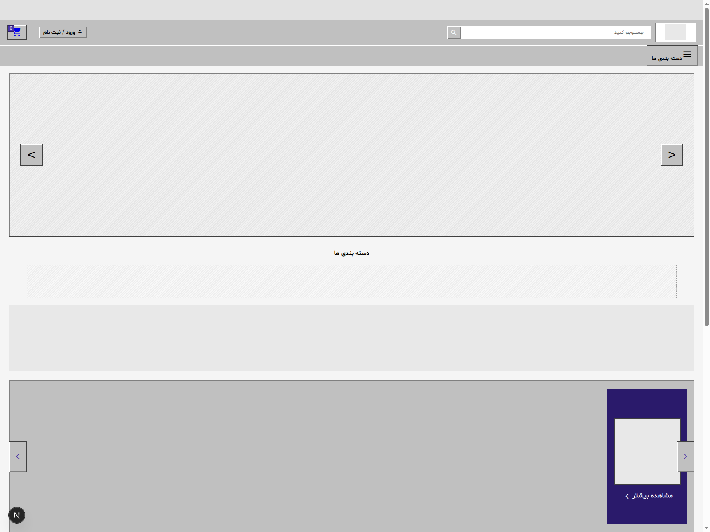

# Mashkala

A Persian (RTL) canned-drinks storefront for **Mashkala** — an art-can soda label — built as a fully-typed **Next.js 16** application. It ships a 150-can catalogue, instant search, product detail pages, a cart with a simulated Zarinpal checkout, a blog, auth pages, and a hand-built late-90s desktop chrome skin.

This is a demo/portfolio project. There is no real backend, payment provider, or authentication service — checkout, login, comments, and newsletter run client-side (with a mocked payment round-trip) so the whole UX can be evaluated without any server setup.

## UI preview



---

## Features

- **150-can catalogue** — fruit, modern, classic, night, dark cola, candles, plus a 90-can art collection (cyber, calligraphy/eye, pigeon, swimmer, cloud, red-coat, frog families) with Persian names, copy, and prices
- **Product routes** — `/products` grid with category chips (`?cat=new`, `?cat=fruit`, …), and `/product/[id]` detail pages with breadcrumbs, quantity picker, add-to-cart, and related products
- **Instant search** — header search over every product and blog post with Persian-normalized matching (ی/ك/ZWNJ), thumbnails, arrow-key navigation, `Enter` to open, `Esc`/click-outside to close, and `/` as a shortcut
- **Shopping cart** — add/remove/update quantities, discount codes, shipping calculation, order summary, checkout flow with loading/success states, empty/loading states, persisted to `localStorage`
- **Blog** — article listing + detail pages with table of contents, rich content blocks (headings, images, quotes, code, lists), tags, social sharing, related articles, comments, and prev/next navigation
- **Authentication pages** — polished login & register cards with client-side validation, inline errors, and loading/success states
- **Full site navigation** — top menu, main nav, categories mega-menu with per-collection children, mobile slide-in drawer, bottom navigation, and footer link columns
- **Micro-interactions** — global add-to-cart toast, cart badge bump, hero slider with 5s autoplay (pauses on hover/focus) plus indicator dots, toast feedback across pages
- **90s chrome skin** — `app/chrome.css` layers a desktop-window frame, beveled controls, and square corners (`border-radius: 0`) over the storefront for a deliberate retro look
- **Fully responsive** — desktop, tablet, and mobile layouts, including a dedicated mobile bottom navigation bar
- **Accessible** — semantic HTML, ARIA attributes, keyboard navigation, and focus states throughout

## Tech stack

| | |
|---|---|
| **Framework** | [Next.js 16](https://nextjs.org/) (App Router, Turbopack) |
| **Language** | TypeScript (strict mode) |
| **UI** | React 19 |
| **Styling** | Plain CSS — `app/globals.css` (storefront) + `app/chrome.css` (90s window skin) — see [Notes on styling](#notes-on-styling) |
| **State** | React Context (`CartContext`) + small external stores (`lib/cart-store.ts`, `lib/toast-store.ts`) |
| **Linting** | ESLint (flat config, `next/core-web-vitals` + `next/typescript`) |
| **Images/Fonts** | `next/image` + `next/font`-friendly local webfont |

No external services, API keys, or environment variables are required: the Zarinpal client falls back to a local sandbox mock when no merchant config is present.

## Pages / routes

| Route | Description |
|---|---|
| `/` | Homepage — hero slider, categories, «کلکسیون جدید» row, product rails, banners, blog rail, "why us" |
| `/products` | Full catalogue with category filters (`?cat=new`, `?cat=fruit`, `?cat=modern`, `?cat=classic`, `?cat=night`, `?cat=dark-cola`, `?cat=candle`) |
| `/product/[id]` | Product detail — breadcrumb, price, quantity + add to cart, related products |
| `/cart` | Shopping cart with summary, discount codes, and checkout |
| `/payment/callback` | Mock payment result page |
| `/blog` | Blog listing |
| `/blog/[slug]` | Blog article detail |
| `/login` | Login page |
| `/register` | Registration page |
| `/api/payment/request`, `/api/payment/verify` | Simulated payment gateway endpoints |

## Getting started

**Prerequisites:** Node.js 18.18+ (or 20+) and npm.

```bash
# 1. Clone the repository
git clone <your-repo-url>
cd mashkala

# 2. Install dependencies
npm install

# 3. Run the dev server
npm run dev
```

Open [http://localhost:3000](http://localhost:3000) in your browser.

### Other scripts

```bash
npm run build   # production build
npm run start   # run the production build
npm run lint    # run ESLint
```

### Product image imports

The raw can photos live in the git-ignored `products/` folder. Two scripts turn them into the 780×1170 JPEGs used by `next/image`:

```bash
# first wave (29 photos, matched by filename order)
node scripts/import-product-images.mjs products public/images/products

# art-can wave (90 photos, matched by scripts/new-product-map.json)
node scripts/import-new-batch.mjs products public/images/products
```

`scripts/import-ui-assets.mjs` does the same for the hero/banner/UI artwork.

## Project structure

```
app/
  layout.tsx              Root layout (metadata, fonts, CartProvider, ToastHost)
  page.tsx                 Homepage
  globals.css               Storefront stylesheet
  chrome.css                90s desktop-window skin
  products/page.tsx         Catalogue grid + category filters
  product/[id]/page.tsx     Product detail page
  cart/page.tsx             Cart page
  payment/callback/         Mock payment result
  blog/page.tsx             Blog listing
  blog/[slug]/page.tsx      Blog article detail
  login/page.tsx            Login page
  register/page.tsx         Register page
  api/payment/              Simulated payment request/verify endpoints
components/
  chrome/                  Desktop window frame
  layout/                  Header, instant search, footer, nav, mobile drawer, back-to-top…
  home/                    Homepage sections (hero, categories, product rows, banners, blog rail…)
  product/                 Catalogue card + product purchase panel
  cart/                    Cart line items, quantity stepper, summary, empty/loading states
  blog/                    Article content, TOC, meta, comments, share buttons, related posts
  auth/                    Login/register forms, shared form field, social buttons
  shared/                  Cross-page components (newsletter form)
  ui/                      Small generic building blocks (Material icon, toast host)
contexts/
  CartContext.tsx           Global cart state (persisted to localStorage)
hooks/                     Reusable hooks (hero slider, horizontal scroll, scroll threshold)
constants/
  data.ts                   All site content (products, categories, blog posts, nav links…)
types/
  index.ts                  Shared TypeScript interfaces
lib/
  cart-store.ts             Cart persistence/state store
  catalog.ts                Catalogue, filtering, breadcrumb and related-product helpers
  toast-store.ts            Global toast store
  format.ts                 Persian-numeral currency formatting
  zarinpal.ts               Zarinpal client with local sandbox fallback
scripts/
  import-product-images.mjs First-wave photo importer (order-based)
  import-new-batch.mjs      Art-can importer (mapped by new-product-map.json)
  new-product-map.json      Source filename → catalogue id mapping for the 90 cans
public/
  images/                  Site images (150 product photos, banners, categories)
  fonts/                   Shabnam webfont
```

## <a name="notes-on-styling"></a>Notes on styling

The original site's CSS relies on deep, specific nested selectors (e.g. `footer .main-footer .support-col .support-col-phone .phone .prefix`). To guarantee a pixel-accurate rebuild, that stylesheet was kept as a single global CSS file rather than split into CSS Modules or rewritten in Tailwind, while the **markup** was fully componentized into small, typed, reusable React components. New surfaces (search, catalogue, product detail, toast, hero dots, banners) are added in `app/chrome.css` and reuse the chrome variables (`--bevel-out`, `--bevel-in`, `--chrome-*`, `--selection`); the skin intentionally forces square corners. The CSS can be incrementally migrated to CSS Modules per component without visual changes, since class names are already scoped predictably.

## Known limitations

- No real backend: cart checkout, login/register, comments, and newsletter signup are simulated with `setTimeout` and local state — see `components/cart`, `components/auth`, `components/blog/CommentSection.tsx`, and `components/shared/NewsletterForm.tsx` to wire up real endpoints. Payments round-trip through `/api/payment/*` and the mock `/payment/callback` page instead of Zarinpal proper.
- Product/blog data is static editorial content in `constants/data.ts`; there is no CMS or database.
- Social login buttons (Google/GitHub) are decorative and show a demo notice instead of performing real OAuth.
- The 90-can art batch is tagged with `collection: "new"` for catalogue filtering; adding more collections means extending that tag and the row/filter data together.

## License

This project is available under the [MIT License](./LICENSE).
